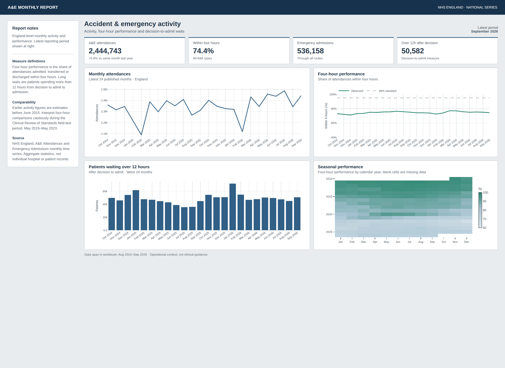

# Hospital Patient Analytics Dashboard

An England-level A&E activity dashboard built from the official NHS England monthly time series. It follows attendance volume, the share within four hours, emergency admissions and waits longer than 12 hours after a decision to admit.



## Run it

```bash
python -m pip install -r requirements.txt
python src/dashboard.py
python src/render_dashboard.py
```

The source workbook is included at `data/nhs_monthly_ae_timeseries_sep2026.xls`. The script writes cleaned monthly records to `outputs/england_monthly_ae.csv` and creates `outputs/dashboard.html`.

## Included files

- `src/dashboard.py` — reads the workbook, prepares measures and writes the dashboard.
- `outputs/dashboard.html` — interactive trend charts and a seasonal performance heatmap.
- `outputs/dashboard.png` — static preview.
- `outputs/england_monthly_ae.csv` — cleaned England-level monthly observations.

## Definitions and caveats

The four-hour percentage is the share of attendances admitted, transferred or discharged within four hours. The 12-hour wait count measures time from decision to admit until admission; it is not total time spent in A&E. These are national aggregate statistics, not patient records or individual-hospital comparisons.

NHS England notes that monthly activity before June 2015 is estimated from weekly data. It also advises care comparing four-hour performance during the Clinical Review of Standards field-test period from May 2019 to May 2023. This is an operational learning project, not clinical guidance.

## Source

NHS England, A&E Attendances and Emergency Admissions: https://www.england.nhs.uk/statistics/statistical-work-areas/ae-waiting-times-and-activity/

The bundled workbook is the September 2026 England time series published 8 October 2026.
